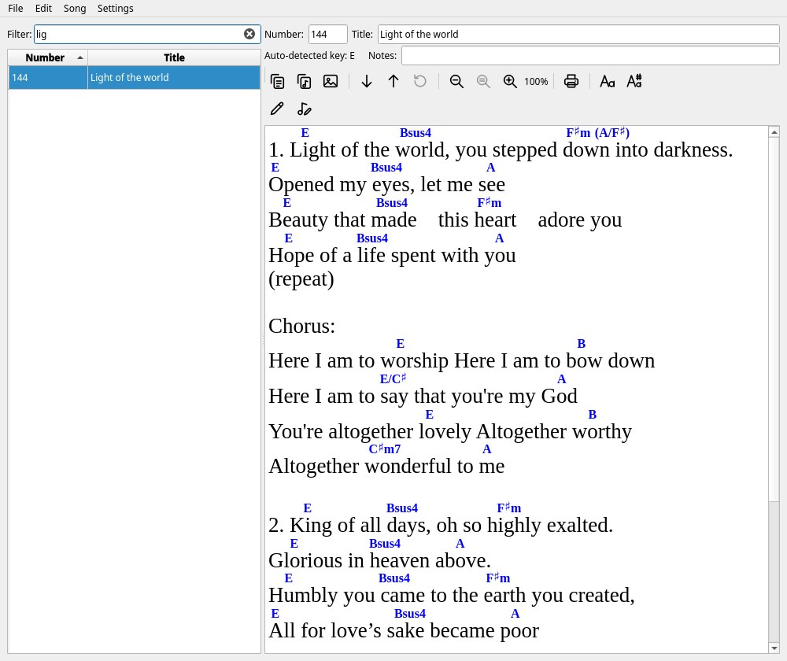

# softChord

A cross-platform editor for songs with chords. Chords are attached to individual letters in the lyrics (not lined up with spaces), so they stay in place as you edit. Songs are stored together in a songbook file.

**Web viewer:** [open the songbook on any phone or computer](https://matvey83.github.io/softChord/softChord_web/) (hosted with GitHub Pages). The songbook is read-only there; the song text can be edited with *Edit text* (best on a large screen) and the chords with *Edit chords* ([docs/chord_editing.md](docs/chord_editing.md)), but changes are lost when the page is left (see [docs/lyric_editing.md](docs/lyric_editing.md)).



## Features

- Edit lyrics and chords in a simple desktop UI
- Store many songs in one `.songbook` file
- Chords move automatically when lyrics change (same rule on desktop, iOS and web, see [docs/lyric_editing.md](docs/lyric_editing.md))
- Transpose songs
- Use any font or size for lyrics and chord symbols
- Import and export plain text (chords aligned automatically)
- Import and export [ChordPro](https://www.chordpro.org/)
- Export / print to PDF
- Unicode (UTF-8) lyrics
- Song search

The app is written in Python with [PyQt6](https://www.riverbankcomputing.com/software/pyqt/). PyQt6 bundles Qt, so a separate Qt SDK is not required.

## Songbook format

A `.songbook` is a SQLite file with `PRAGMA user_version = 2`. Each chord is one
text string such as `Am7/G` or `(1:C♯m)`, stored in `song_chord_link.chord`. The
string grammar and the tolerant parser are described in
[docs/chord_format.md](docs/chord_format.md). The whole file format (song uuids,
`updated_at`, `meta`, deleted-song tombstones) is in
[docs/songbook_format.md](docs/songbook_format.md). The same parser cases
(`tests/chord_vectors.json`) are run by the Python, Swift and JS tests.

The desktop editor still opens the old format (separate note, type, bass,
marker and parentheses columns). It converts the file when it opens it, after
saving a backup next to it as `<name>.songbook.v1.bak`. If the file cannot be
changed, it opens a converted temporary copy and asks you to use Save As. The
iPhone app and the web viewer read version 2 only. To convert a file without
the editor: `python3 tools/convert_songbook_v1_to_v2.py FILE...`. Version 2 files
made before song uuids existed are upgraded the same way (backup
`<name>.songbook.pre-uuid.bak`, or `python3 tools/upgrade_songbook_v2.py`).

## Running from source

Requires [Python](https://www.python.org/) 3.10 or newer.

```bash
git clone https://github.com/matvey83/softChord.git
cd softChord
./start_softChord.py
```

On Windows:

```bat
python start_softChord.py
```

To open a songbook at launch:

```bash
./start_softChord.py zvuki_neba.songbook
```

`start_softChord.py` creates a `.venv` virtual environment if needed, installs dependencies from `requirements.txt`, and starts the app. It asks before installing packages.

macOS builds are on [GitHub Releases](https://github.com/matvey83/softChord/releases). Older 0.9.x binaries (2011–2013) remain on [SourceForge](https://sourceforge.net/projects/softchord/).

## Development

Tests and manual runs use a temporary copy of a songbook rather than a repository `.songbook`; see `AGENTS.md`.

### Manual setup

The launcher above is enough for most work. To set up the venv by hand:

```bash
python3 -m venv .venv
source .venv/bin/activate          # Windows: .venv\Scripts\activate
pip install -r requirements.txt
```

Then run either `./start_softChord.py` or:

```bash
.venv/bin/python src/softchord.py
```

`.venv` is listed in `.gitignore`.

To pick up changes to `requirements.txt`:

```bash
pip install -r requirements.txt
```

### Tests

Run from `src/` with the venv active (so `import softchord` works):

```bash
cd src
python3 test_song.py          # unit tests
python3 softchord_test.py     # integration tests (starts a Qt application)
```

The web viewer's tests run with Node (version 22 or newer):

```bash
cd softChord_web
node --test
```

The tests of the Edit text and Edit chords modes and the layout drive the real page in headless Chrome. Chrome is found in the usual places, or set `CHROME_BIN` to its path. Without Chrome those tests are **skipped, not passed**: the run prints a `WARNING ... did NOT run` message and reports them as skipped. To make a missing Chrome a failure (for a CI that must test the browser), run with `SOFTCHORD_REQUIRE_BROWSER=1 node --test`.

### Regenerating UI modules

Windows are defined in Qt Designer `.ui` files. After editing them, regenerate the Python modules:

```bash
pyuic6 src/softchord_main_window.ui -o src/softchord_main_window_ui.py
pyuic6 src/softchord_chord_dialog.ui -o src/softchord_chord_dialog_ui.py
pyuic6 src/softchord_pdf_dialog.ui -o src/softchord_pdf_dialog_ui.py
```

Do not edit the generated `*_ui.py` files by hand.

## Packaging

Standalone builds use [PyInstaller](https://pyinstaller.org/) 6 from `softchord.spec`. The version is `__version__` in `src/softchord_version.py`, the one place it is set; the spec, the app and the CI build read it (`python build_softChord.py --version` prints it).

GitHub Actions (`.github/workflows/build.yml`) builds Apple Silicon and Intel macOS `.dmg`s plus a Windows `.zip` and `.exe` when a `v*` tag is pushed, or on demand via **Actions → Build → Run workflow** (leave *release_tag* empty to only build; the files are on the run page under *Artifacts*). A tag must be `v` plus the version in `softchord_version.py`. If the tag has no GitHub release yet, the workflow creates a draft one with `docs/release_notes/<tag>.md` as its notes.

You can also build locally. Build **on the OS you want to ship** (a Mac cannot produce the Windows `.exe`, and vice versa).

```bash
./build_softChord.py
packaging/macos/sign_and_package.sh "$(./build_softChord.py --version)" arm64   # optional: the DMG
```

On Windows:

```bat
python build_softChord.py
```

The helper uses `.venv`, installs `requirements.txt` and `requirements-build.txt`, then runs PyInstaller. Equivalent manual steps:

```bash
source .venv/bin/activate          # Windows: .venv\Scripts\activate
pip install -r requirements.txt
pip install -r requirements-build.txt
pyinstaller --noconfirm --clean softchord.spec
```

| Platform | Local output | CI release asset |
|---|---|---|
| macOS (Apple Silicon) | `dist/softChord.app` | `softChord-<version>-macos-arm64.dmg` |
| macOS (Intel) | `dist/softChord.app` | `softChord-<version>-macos-x86_64.dmg` |
| Windows | `dist/softChord.exe` | `softChord-<version>-windows.zip` (exe + `How to open softChord on Windows.txt`) and `softChord-<version>-windows.exe` |

`.songbook` files are associated with the app:

- **macOS:** the bundle `Info.plist` declares the type so Finder can open `.songbook` files with softChord.
- **Windows:** the frozen exe registers the extension for the current user on launch (no installer or admin rights). Double-clicking a `.songbook` then starts this copy of `softChord.exe`.

### Signing

**macOS.** `packaging/macos/sign_and_package.sh` signs the app with the hardened runtime (`packaging/macos/entitlements.plist`), builds the DMG (the app plus an Applications link), signs it, notarizes it with `notarytool` and staples the ticket, when these repository secrets are set:

| Secret | Value |
|---|---|
| `MACOS_CERT_P12` | base64 of a `.p12` holding the *Developer ID Application* certificate and its private key |
| `MACOS_CERT_PASSWORD` | the `.p12` password |
| `APPLE_ID` | the Apple ID email used for notarization |
| `APPLE_APP_PASSWORD` | an app-specific password for that Apple ID |
| `APPLE_TEAM_ID` | `BP4KJ52H3T` |

`tools/setup_mac_signing_secrets.sh` sets all five from a Mac that has the certificate in its login keychain (or pass a `.p12` you exported from Keychain Access). It checks the Apple ID and app-specific password with `notarytool` before storing them; `--notary-only` updates just the three Apple values (for example after a notarization 401 in the build, then `gh run rerun --failed <run id>`). Without the secrets the build still succeeds with a warning: the app keeps PyInstaller's ad-hoc signature and the DMG is not notarized, so macOS asks the user to allow it under **System Settings → Privacy & Security → Open Anyway**.

**Windows.** The `.exe` is unsigned, so SmartScreen shows *Windows protected your PC* (**More info → Run anyway**); `packaging/windows/How to open softChord on Windows.txt` ships next to the exe in the zip. An Authenticode certificate would remove the warning.

### Making a release

1. Write `docs/release_notes/v<version>.md` (copy the previous one) and commit it.
2. Run `tools/release.sh <version>` (for example `tools/release.sh 1.2`). It checks that master matches GitHub and the build files are committed, sets the version in `src/softchord_version.py` and commits it, pushes master, creates the draft release with the notes and pushes the tag. The tag starts the build, which attaches the files to the draft.
3. When the run is green, check the assets and publish the draft on GitHub.

The Mac jobs wait up to 10 minutes for Apple. If notarization is still running then (a first submission can take hours), the signed DMG is attached anyway with a `NAME.dmg.notarization-pending` file holding the submission ID, and the build only warns. Once Apple accepts it, run **Actions → Staple → Run workflow** with the tag, or `tools/release.sh --staple <version>` on a Mac with the `softchord-notary` notarytool profile. It staples the DMG, re-uploads it and removes the pending file. Publish after that.

Do not commit `build/` or `dist/` (they are gitignored).
